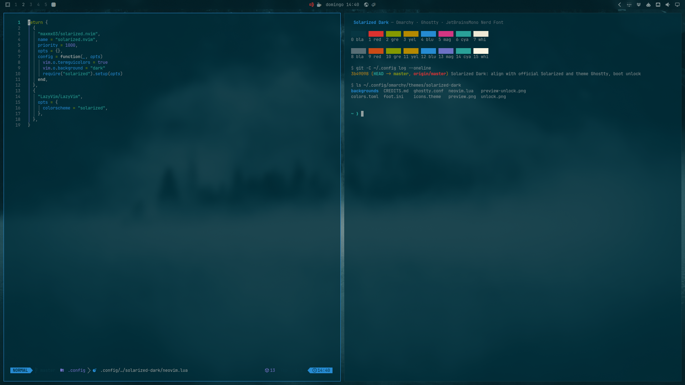
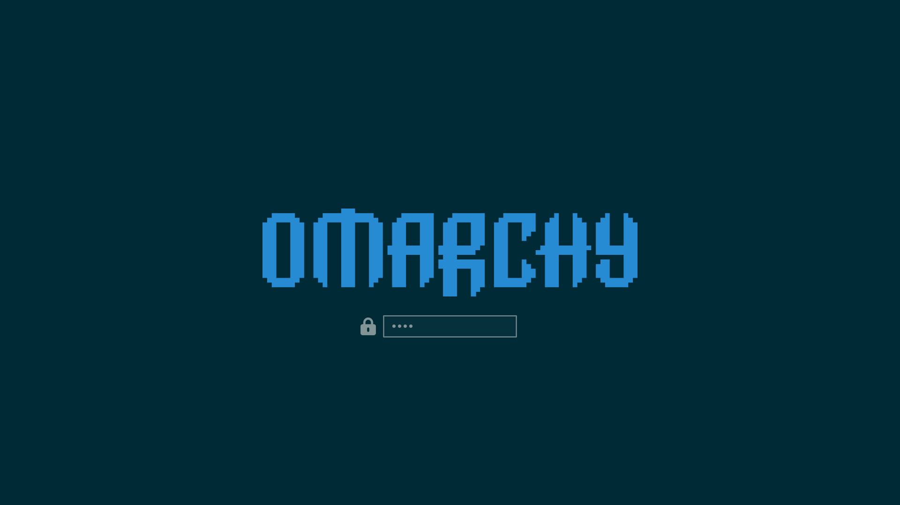

# dotfiles

Tema **Solarized Dark** para [Omarchy](https://omarchy.org/), alinhado com a
[referência oficial do Solarized](https://ethanschoonover.com/solarized/), mais
a configuração de Neovim que o acompanha.



<sub>Ghostty (JetBrainsMono Nerd Font) com a paleta ANSI do tema e Neovim com
[solarized.nvim](https://github.com/maxmx03/solarized.nvim), com o modo glass
(transparência) do Omarchy ligado.</sub>

## Conteúdo

| Caminho | O que faz |
|---|---|
| `omarchy/themes/solarized-dark/colors.toml` | Paleta do tema; o Omarchy gera dela as configs dos apps sem arquivo próprio (alacritty, btop, VS Code…) |
| `omarchy/themes/solarized-dark/ghostty.conf` | Ghostty: ANSI canônico do Solarized e cursor base1 |
| `omarchy/themes/solarized-dark/foot.ini` | foot: a mesma paleta do Ghostty |
| `omarchy/themes/solarized-dark/neovim.lua` | Neovim/LazyVim com `maxmx03/solarized.nvim` |
| `omarchy/themes/solarized-dark/unlock.png` | Logo das telas de desbloqueio do disco (Plymouth), desligamento e login (SDDM) |
| `omarchy/themes/solarized-dark/backgrounds/` | Wallpapers CC0 (fontes em `CREDITS.md`) |
| `nvim/lua/plugins/all-themes.lua` | Instala o solarized.nvim para o hot-reload de tema do Omarchy |

## Paleta

| Papel | Solarized | Hex |
|---|---|---|
| Fundo | base03 | `#002b36` |
| Fundo de realce, seleção, ANSI 0 | base02 | `#073642` |
| Comentários, ANSI 8 | base01 | `#586e75` |
| Texto | base0 | `#839496` |
| Texto em destaque, texto selecionado, cursor | base1 | `#93a1a1` |
| ANSI 7 | base2 | `#eee8d5` |
| ANSI 15 | base3 | `#fdf6e3` |
| Acento | blue | `#268bd2` |

Diferenças em relação ao Solarized clássico, ambas de propósito:

- **ANSI 8 é base01** e não base03: base03 é a própria cor do fundo e deixa
  invisível o texto "dim".
- **Brights mantêm as cores** (o clássico transforma quase todos em cinzas),
  com o laranja (9) e o violeta (13) do Solarized.

## Tela de desbloqueio e desligamento



A mesma arte aparece ao pedir a senha do disco no boot, ao desligar e ao
reiniciar; o login (SDDM) usa o mesmo fundo e logo.

## Instalação

O repositório espelha `~/.config`. Em outra máquina com Omarchy:

```bash
git clone https://github.com/Esegnorelli/dotfiles /tmp/dotfiles
cp -r /tmp/dotfiles/omarchy/themes/solarized-dark ~/.config/omarchy/themes/
cp /tmp/dotfiles/nvim/lua/plugins/all-themes.lua ~/.config/nvim/lua/plugins/

omarchy theme set solarized-dark
omarchy plymouth set by theme solarized-dark   # boot/desligamento/login; pede sudo
```

Não clone o repositório nem crie um `.git` **dentro** de
`~/.config/omarchy/themes/solarized-dark`: o Omarchy trata um tema com `.git`
como instalado de terceiros e ignora `ghostty.conf`, `foot.ini` e `neovim.lua`.

Terminais foot já abertos só pegam a paleta deste tema depois de reabertos; o
Ghostty recarrega sozinho.

## Créditos

- [Solarized](https://ethanschoonover.com/solarized/), de Ethan Schoonover
- [solarized.nvim](https://github.com/maxmx03/solarized.nvim), de maxmx03
- Wallpapers: ver [`CREDITS.md`](omarchy/themes/solarized-dark/CREDITS.md)
